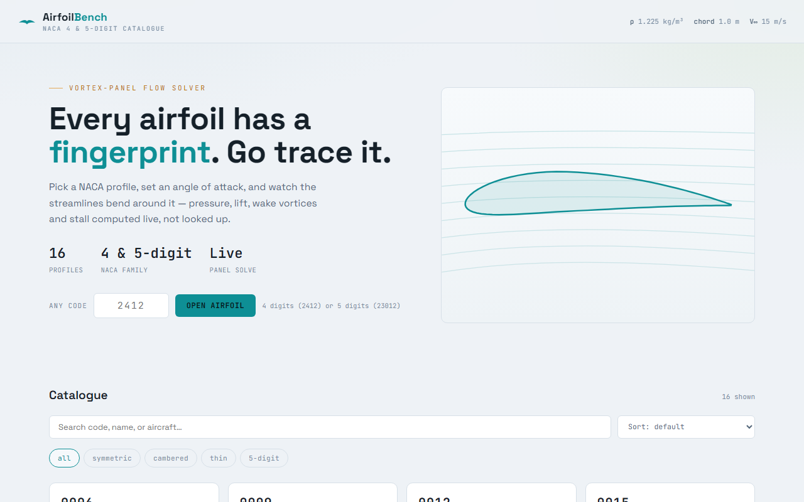

# Airfoil Bench - NACA Catalogue and Flow Visualizer

**Pick a NACA airfoil, set an angle of attack, and watch the flow bend around it.** Streamlines, pressure, lift, wake vortices and stall are computed live by a vortex-panel solver, not looked up from a table.

**[Try it live](https://vishwakvemuru.github.io/Airfoil_Bench/)** - runs in your browser, nothing to install.

## Features
- 16 profiles in the catalogue, searchable and filterable (symmetric, cambered, thin, 5-digit)
- Open any NACA 4-digit or 5-digit code, for example `2412` or `23012`
- Live vortex-panel flow solve
- Shows air density, chord and free-stream speed for the current setup
- Single static page: no server, no build step

## Run locally
Download the repo and open `AirfoilBench_v3.html` in any browser. `v1` and `v2` are earlier versions.

## Related
[AeroMatch](https://github.com/VishwakVemuru/AeroMatch) | [AeroCatalogue](https://github.com/VishwakVemuru/AeroCatalogue) | [Aircraft Classifier](https://github.com/VishwakVemuru/AircraftClassifier)

If this is useful, a star helps others find it.

Built by [Vishwak Vemuru](https://github.com/VishwakVemuru). MIT licence.

